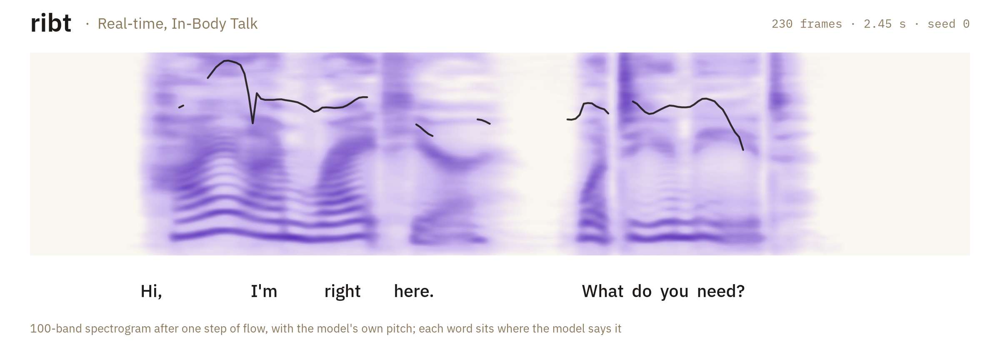
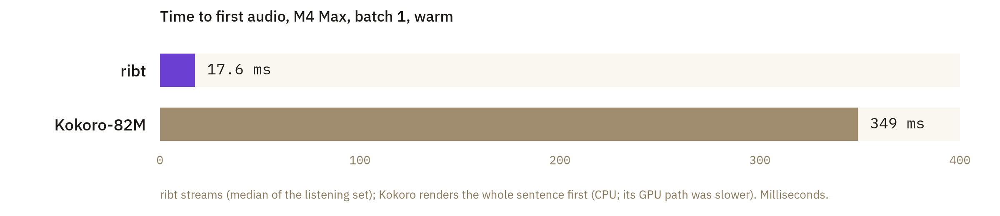
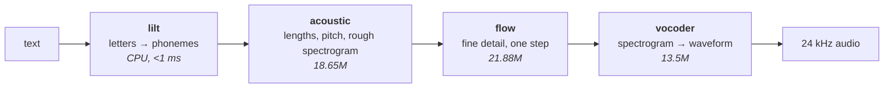

<picture>
  <source media="(prefers-color-scheme: dark)" srcset="assets/readme/hero-dark.png">
  
</picture>

# ribt

**Real-time, In-Body Talk.** A small English voice for robots that have to answer while you're
still in the room. It starts speaking 17.6 ms after it gets the text, and it runs the same compiled
programs on a Mac, a robot's GPU and your browser.

[**Hear it in your browser →**](https://ribt.dev) &nbsp;·&nbsp;
[Weights](https://huggingface.co/municipal-robotics/ribt) &nbsp;·&nbsp;
[Paper](https://muni.works/research/ribt) &nbsp;·&nbsp;
MIT

## Why first audio is the number that matters

People take turns in conversation with gaps of about 200 ms. Past 300–400 ms, a reply starts to
feel hesitant. A robot's budget from the end of your sentence to its first sound has to cover
speech recognition, deciding the turn is over, and writing a reply, so the share left for speech
synthesis is small.

Most TTS systems are judged by throughput: how many seconds of audio per second of compute. That's
the wrong number for a conversation. A model that renders a whole sentence before playing any of
it can be fast overall and still leave you waiting. ribt is built to make the *first* sample cheap,
then keep ahead of playback.

<picture>
  <source media="(prefers-color-scheme: dark)" srcset="assets/readme/latency-dark.png">
  
</picture>

## How a sentence becomes sound



1. **Letters become sounds.** English spelling is a poor guide to pronunciation, so the first
   step is a dictionary, a part-of-speech tagger and rules for everything else. **lilt** is a Rust
   port of hexgrad's misaki: it knows the two readings of "read" from the tense around it, says
   "$42.50" as money, and never drops a word it hasn't seen. It matches misaki on 99.86% of words
   in held-out text, at 274k words a second.
2. **Every sound gets a length and a pitch.** The acoustic model reads the phonemes and decides
   how long to hold each one, in 10.7 ms frames, and where the voice rises and falls. Its decoder
   then sketches a 100-band spectrogram: a picture of the sound, one column per frame.
3. **One step of flow adds the detail.** The sketch is smooth and a little muffled. A flow-matching
   model learns to move it toward real speech. Its teacher needed 16 steps; ribt runs a student
   distilled to a single step that matches it.
4. **The vocoder turns the picture into air.** A spectrogram has no phase, so it can't be played.
   The vocoder fills the phase in and writes 24,000 samples a second. ribt uses
   [Vocos](https://github.com/gemelo-ai/vocos), imported weight for weight into its own graph.

Streaming works by running these stages in chunks: the first clause's audio is playing while the
rest of the sentence is still being computed.

## One IR, every target

Every network in ribt is a program in [tang](https://github.com/muni-works/tang)'s tensor IR.
Training is the same IR with its derived backward pass, so no PyTorch appears in any training
loop. A program is written once and lowered to whatever the machine has:

| target | build | used for |
|---|---|---|
| Metal | `cargo build --release` | Macs (the default) |
| CUDA | `--no-default-features --features cuda` | training on NVIDIA |
| wgpu | `--no-default-features --features wgpu` | portable GPU |
| OpenCL | `--no-default-features --features opencl` | the robot's Adreno GPU |
| C | `--no-default-features --features cpu` | CPUs, via the system `cc` |
| WebGPU | `web/build.sh` | [ribt.dev](https://ribt.dev): no server, nothing leaves the page |

The browser build matches the native one on the same weights to within 6e-5 relative RMS.

## Speak

```bash
git clone https://github.com/muni-works/ribt && cd ribt
cargo build --release
hf download municipal-robotics/ribt --local-dir ribt-weights
```

```bash
W=ribt-weights
target/release/ribt-tts synth --run $W --ckpt acoustic.safetensors \
  --flow $W/flow.safetensors --nfe 1 --shortcut --temp 0.3 \
  --voc $W/vocoder.safetensors --ref $W/ref.wav \
  --seed 0 --pitch 1 --accent minnesota \
  --text "Hi, I'm right here. What do you need?" --out-dir out/
```

Swap `synth` for `stream` to hear it chunk by chunk; each committed phoneme and its sample offset
print to stderr. The knobs are `--pitch` (semitones), `--rate`, and `--accent neutral|midwest|minnesota`.
The default voice is up a semitone with a light Upper-Midwest accent: a raised *æ* before *g*, as
in "bag", and a held *o*. It says "ope" when it should.

Phonemes only: `target/release/ribt lilt say "Hannah paid \$3.50 at 4:15."`

## In the browser

```bash
web/build.sh ribt-weights            # lilt → wasm, every model → WGSL, weights → fp16
python3 -m http.server 8737 -d web   # then open /index.html, or /parity.html to check it
```

`web/ribt.js` has no model code of its own. It uploads buffers and dispatches the kernels tang
exported, in order, and reports each stage as it lands. [`web/README.md`](web/README.md) has the
API and the parity table.

## How good is it

Measured on an M4 Max, seed 0. Word error rate from Whisper small.en, naturalness from UTMOS
(utmos22_strong), speaker similarity as WavLM-SV cosine to 121 held-out clips of the target voice.

| | ribt | Kokoro af_heart |
|---|---|---|
| Time to first audio | **17.6 ms** (streaming) | 349 ms (whole sentence) |
| Real-time factor | **0.027** | 0.093 |
| Naturalness, UTMOS | 4.39 | **4.52** |
| Word error rate, WER-50 | 2.71% | 2.61% |
| Word error rate, held-out 50 | 1.73% | 1.73% |
| Speaker similarity | 0.987 | 0.990 |

Kokoro still sounds a little better, by about 0.13 UTMOS. We set out to beat it and didn't; the
[paper](https://muni.works/research/ribt) describes the attempts, and why what's left of the gap
comes from the teacher and the metric rather than the architecture.

## Where the voice comes from

ribt's voice is distilled from [Kokoro-82M](https://huggingface.co/hexgrad/Kokoro-82M)'s `af_heart`
voice (Apache-2.0). We rendered 135 hours of af_heart and trained our own models on it. No Kokoro
weights are in ribt. Kokoro's own training data included synthetic audio from closed commercial TTS
providers, so the voice inherits that lineage. [`release.toml`](release.toml) records every file,
checksum and setting.

## Repository

| path | what |
|---|---|
| `src/lilt/` | the G2P: tokenizer, tagger, lexicons, numbers, unknown words, streaming `Phonemizer::push` |
| `src/acoustic.rs`, `src/flow.rs` | the acoustic model and the flow decoder, as fixed-shape IR graphs |
| `src/model.rs`, `src/gan.rs` | vocoder, log-mel frontend, iSTFT, losses; discriminators for GAN training |
| `src/align.rs` | the aligner that gives training data its phoneme durations |
| `src/runtime.rs` | compiles and runs IR programs on the one backend this build has |
| `src/bin/` | `ribt` (vocoder, lilt), `ribt-tts` (synthesis, streaming, training), `ribt-align`, `ribt-web-export` |
| `web/` | the browser build |
| `data/lilt/` | lexicons, tagger weights and parity goldens, with their licenses in `NOTICE` |

Everything trains in the IR: `ribt train` and `ribt gan` (vocoder), `ribt-align train` then `durs`
(durations), `ribt-tts train` (acoustic), `ribt-tts flow-train` (flow teacher, then `--distill` for
the student). Each binary's flags are documented at the top of its source file. Touch `RUN/STOP` to
checkpoint and exit; rerun to resume.

## Cite

```bibtex
@misc{pedersen2026ribt,
  title  = {Real-time, In-Body Talk: a small streaming voice, trained in one tensor IR},
  author = {Pedersen, Cam},
  year   = {2026},
  howpublished = {Municipal Robotics},
  url    = {https://muni.works/research/ribt}
}
```

## License

MIT. lilt ports hexgrad's [misaki](https://github.com/hexgrad/misaki) (Apache-2.0); its lexicons ship
under Apache-2.0 with attribution in [`data/lilt/NOTICE`](data/lilt/NOTICE). The vocoder weights are
Vocos by Hubert Siuzdak (MIT).

Built by [Municipal Robotics](https://muni.works), alongside [tang](https://tang.toys) and
[phyz](https://phyz.dev).
